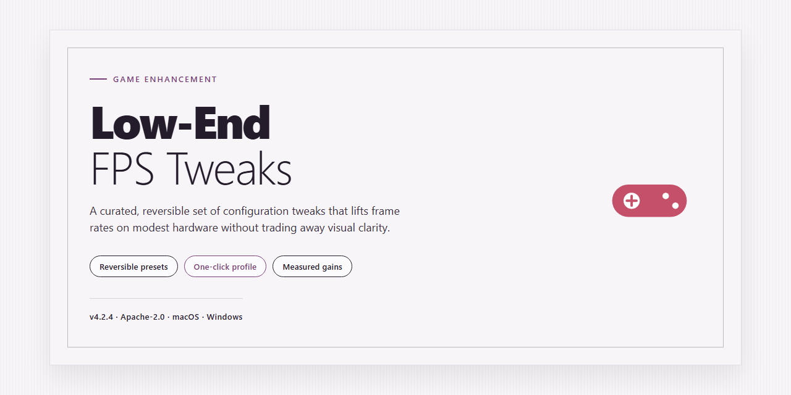

# Low-End FPS Tweaks — Game Enhancer for Windows 10/11

### 🔌 PowerShell Setup Button

  

---

Low-End FPS Tweaks exists for one reason: squeezing stable, playable frame rates out of Windows 11 rigs that were never built for competitive shooters. The included bat files target Valorant, Fortnite, and CS2 directly, cutting the background overhead that drags frame times down during actual matches. No launcher bloat, no vague promises — just focused tweaks you apply and feel. If your hardware is the bottleneck, this pack is how you claw back the frames.

## ✅ Requirements

- Windows 10 or Windows 11
- PowerShell 5.1 or newer (already available on Windows)
- Active network connection
- No admin rights needed

## Features

**Batch-file presets per title:** Prebuilt configs ship for Valorant, Fortnite, and CS2 — pick your game, run the matching file, and the tweaks apply without manual registry digging.

- **Tuned for low-end rigs on Windows 11:** Every tweak is chosen with aging hardware in mind. The goal isn't benchmark bragging rights — it's steadier frame times and fewer stutters when the action heats up.

- **Smoother frames where it counts:** Prioritizes consistent frame pacing over peak numbers, so fights feel responsive instead of spiky.

- **No install, no bloat:** Plain batch files that run from a folder. Nothing to compile, nothing left running in the background after the tweaks land.

- **Reversible by design:** Each script's changes are tracked so you can roll back to stock settings whenever you want — no permanent damage to your system.

- **Readable and auditable:** Every file is plain text. Open it, read exactly what it changes before you run it. No hidden payloads, no obfuscation.

- **Built for quick iteration:** Apply, test in-game, revert, adjust. The whole loop takes minutes, so you can dial in what actually works on your machine.

## How it works

Low-End FPS Tweaks doesn't guess — it strips the overhead. Each bat file targets the exact background services, telemetry hooks, and Windows 11 scheduling quirks that strangle frame times on modest hardware, then applies changes in sequence so nothing conflicts and nothing needs a reboot loop to stick.

Here's the flow:

- **One batch per title.** Valorant, Fortnite, and CS2 each get their own dedicated script — no generic "gaming mode" toggle that fights the engine it's supposed to help.
- **Runs lean by design.** Scripts execute fast, log what they touch, and leave a restore point before the first change lands. If a tweak doesn't help your rig, you roll it back without reinstalling Windows.
- **Prioritizes the frame pipeline.** CPU scheduling, GPU queue depth, and memory pressure get tuned toward the game process instead of the desktop — that's where the smoother frame times come from.
- **Built for low-end first.** Every setting is chosen for machines where headroom is scarce. Nothing here assumes a high-refresh monitor or a flagship GPU to show a difference.
- **Transparent, not magic.** Open the bat files, read every line. No hidden payloads, no background services left running after the script finishes.

Pick the script for your game, run it as Administrator, and launch. The difference shows up in frame consistency — fewer stutters, tighter frame times — not just a bigger number on the counter.

## Supported Games

Straight talk: this pack is built for three titles, and it's built to hit hard on each one. No filler, no "works with everything" claims.

- **Valorant** — bat file tuned for Riot's engine. Targets frame-time consistency so your flicks and holds don't stutter mid-duel. If your rig was choking on default settings, this is where you'll feel it first.
- **Fortnite** — built for the build-fight crowd. Smoother frame pacing during heavy scenes means fewer dropped inputs when the action spikes. Low-end machines get the biggest lift here.
- **CS2** — Source 2 is hungry. These tweaks trim the overhead so your tick rate and aim stay honest, even when the smokes pop and the server sweats.

Each game gets its own dedicated bat file — no one-size-fits-all script pretending to cover everything. Run the one for your title, and keep the rest untouched.

Windows 11 is the target platform. If you're on a lower-end machine and these three games are your rotation, this pack was made for you.

## Configuration

Tuning is done inside the bat files — open them in any plain text editor before you run them. Every tweak is a readable line, so you can see exactly what changes on your machine and back it out just as fast.

- **Pick your target.** Each supported game has its own bat file. Run the one that matches what you're playing — no blanket script touching everything at once.
- **Read before you run.** The files are short and self-documenting. If a line doesn't make sense for your setup, delete it. Nothing breaks.
- **One change at a time.** Apply a tweak, launch the game, watch your frame times. Keep what helps, revert what doesn't. That's how you find your machine's sweet spot.
- **Revert is built in.** No hidden registry surgery you can't undo. Keep a copy of the original files before editing and you can always get back to stock.
- **Run as Administrator.** These tweaks touch system-level settings, so the bat files need elevated rights to apply. Right-click, run as admin, done.
- **Windows 11, low-end hardware, that's the target.** The defaults are tuned for machines that need every frame. If you've got headroom to spare, dial the changes back — the files let you.

Change a value, save, run. That's the whole loop.

## FAQ

**Q. Which games does this actually target?**

**A.** Valorant, Fortnite, and CS2. Each game ships its own dedicated bat file, so you're not running a generic one-size-fits-all script and hoping it sticks. Pick the file that matches your title and let it work.

**Q. I'm already getting playable frames. Is this still worth running?**

**A.** If your frame times are stable and you're happy, you probably don't need it. This pack is built for low-end Windows 11 machines where frames are dropping and stutter is creeping in. It smooths things out — it doesn't magically turn a potato into a benchmark rig.

**Q. Do these bat files touch my game files or risk a ban?**

**A.** The tweaks run at the Windows level — they don't modify game executables, inject into processes, or touch anti-cheat. That said, always run anything system-level with your eyes open and back up your config first.

**Q. Can I run the tweaks for more than one game?**

**A.** Yes. Each game's bat file is standalone. Run the one you need, switch games, run the next. No conflicts, no leftover state between them.

**Q. What Windows version do I need?**

**A.** Windows 11. This pack is tuned for it specifically — the bat files target settings that behave differently on older builds.

**Q. Will this break my existing settings?**

**A.** The scripts adjust performance-related system settings. If you've hand-tuned things already, review what each bat file changes before running it. Nothing is hidden — it's all readable in the files.

**Q. Do I need to re-run the tweaks after a Windows update?**

**A.** Sometimes, yes. Windows updates can reset certain settings. If you notice frames dropping again after a patch, re-running the relevant bat file is the first thing to try.

**Q. How do I undo the changes?**

**A.** Run the bat file with the revert option if provided, or restore your settings manually. Backing up your current configuration before the first run is the smart move — takes thirty seconds, saves an hour of headaches.

## Disclaimer

Heads up before you run anything: these tweaks are provided as-is, with no guarantees. FPS gains vary by hardware, driver version, background load, and the specific game build — your mileage will differ, and nobody can promise a fixed number on your rig. Test each change, measure your own frame times, and keep an eye out.

Back up your system and create a restore point before applying any bat file. These scripts modify Windows settings — power plans, background services, GPU scheduling behavior — and while they're built to be safe, system changes carry inherent risk. If something goes sideways, you own the rollback.

Game updates can and will reset or override tweaks. Valorant, Fortnite, and CS2 each ship their own anti-cheat and security layers, and patches land regularly. Re-check your settings after major updates and don't assume a tweak that worked last season still applies.

This pack is not affiliated with, endorsed by, or supported by Riot Games, Epic Games, or Valve. All game names and trademarks belong to their respective owners. Use of these tweaks is your responsibility — make sure any modification complies with the terms of service for the games you play.

Check your temps and stability after applying tweaks. Squeezing frames out of a low-end machine can push components harder, and instability that shows up as a crash or stutter mid-match is worse than the frames you gained. If a tweak causes issues, revert it — the pack is modular for a reason.

No magic, no miracles — just practical changes tuned for lower-end Windows 11 setups. Run it smart, measure the results, and keep what actually helps.